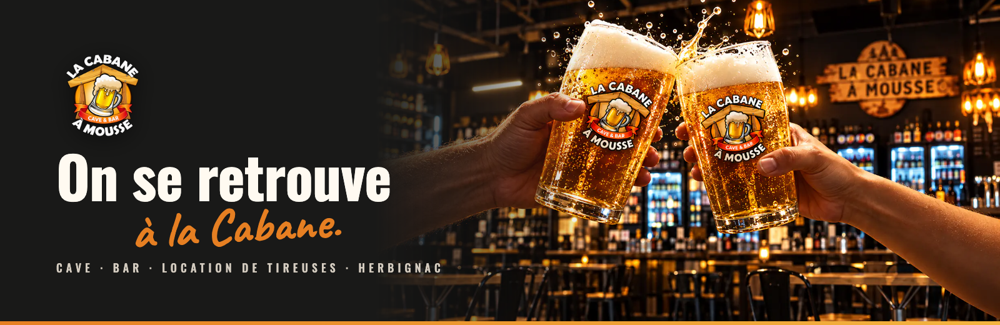
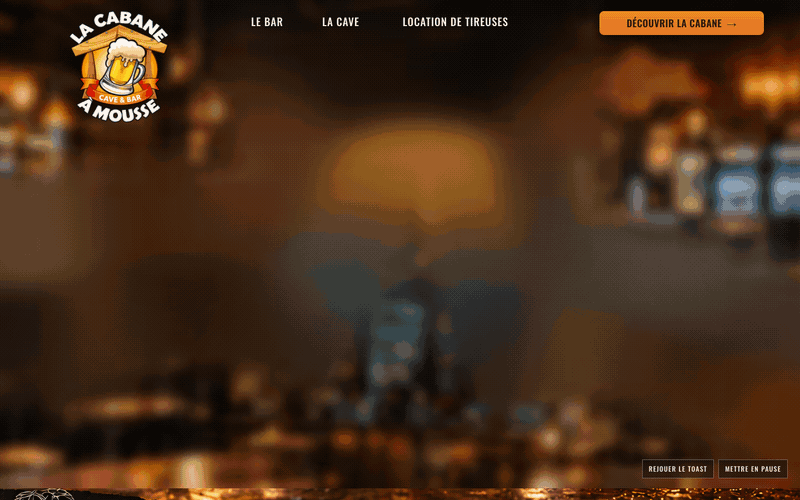
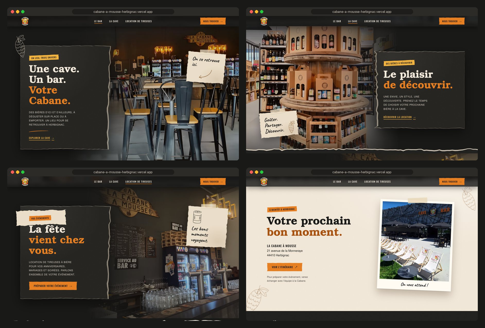
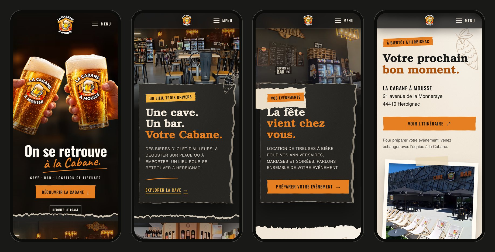
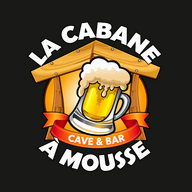

<div align="center">



<h3>A one-page website for a beer cellar, bar and tap-hire business in Herbignac, opened by a toast between two glasses.</h3>

<p>
  <a href="https://cabane-a-mousse-herbignac.vercel.app"><strong>🌐 Live site</strong></a>
  &nbsp;·&nbsp;
  <a href="#hero-animation"><strong>🎬 How the hero works</strong></a>
  &nbsp;·&nbsp;
  <a href="#getting-started"><strong>🛠️ Run it locally</strong></a>
</p>

<p>
  <a href="https://cabane-a-mousse-herbignac.vercel.app"></a>
  
  
  
  
</p>

</div>

<br />

## 🚀 Overview

**La Cabane à Mousse** is a beer cellar, a bar and a tap-hire service at 21 avenue de la Monneraye in Herbignac. The site is built on one idea from the brief: *On se retrouve à la Cabane.* Two hands raise their glasses over the bar's real room, the rims meet, and the title appears. Then the page turns into a scrapbook: torn paper panels and handwritten notes laid over photos of the actual bar, cellar and counter.

The page is in French, like the business. It walks visitors from the toast to the three things the Cabane does (the bar, the cellar, tap hire) and ends with the address and directions.

- **A warm first impression**: a 2.8 s toast built from two transparent layers, not a video, with French replay and pause controls
- **The real place**: every section after the hero uses the venue's own photos, so the page looks like the room visitors walk into
- **Honest content**: no invented prices, opening hours, stock or booking forms; tap hire leads to a conversation with the team
- **Built for every visitor**: works without JavaScript, respects reduced motion, full keyboard support, 724 KB first load on desktop and 612 KB on a phone

<br />

<a name="hero-animation"></a>

## 🎬 The hero animation

<div align="center">
  <a href="https://cabane-a-mousse-herbignac.vercel.app"></a>
  <sub>Plays once on load on the live site · captured at 1440 × 900, 15 fps</sub>
</div>

<br />

The toast follows the kit's motion script and plays once, without locking the scroll:

| Time         | What happens                                                                                                                       |
| :----------- | :--------------------------------------------------------------------------------------------------------------------------------- |
| 0–1.25 s     | The bar's own room, sharp; two hands come in from the sides while the room racks into soft focus                                   |
| 1.25–1.65 s  | The rims meet: a short rebound, a warm flash, two rings and a handful of bubbles                                                    |
| 1.65–2.8 s   | The pose settles; **On se retrouve** rises, **à la Cabane.** writes itself, the underline draws, then the tagline and **Découvrir la Cabane** |
| On scroll    | Room, glasses and title drift at different speeds; a torn cream edge stitches the hero to the first section                        |

**Under the hood**

- 🧩 **Two transparent layers on a stage.** The hands and glasses sit on a 16:10 stage that covers the hero like a photo (container query units), with its own pose on a taller stage for phones. The cut end of each forearm is masked and the sides fall into shadow, so the arms always come from off screen.
- 📐 **Measured, not guessed.** The two layers were rendered separately from the campaign photo, so they cannot be registered to it (feature matching even mistook one glass's logo for the other's). `scripts/compose-hero.py` measures each rim and glass height from the alpha channel, scales both glasses to the same height and puts the two rims on one contact point. It writes the CSS and a composite image to check the pose.
- ⏱️ **One clock.** Thirty Web Animations share the same 2.8 s timeline, so **Mettre en pause**, **Reprendre** and **Rejouer le toast** act on the whole scene at once.
- 🐢 **Graceful by default.** With `prefers-reduced-motion` the hero shows the final pose and no controls. Arriving through a link such as `#cave` skips straight to the end. Without JavaScript, or if a layer fails to load, the hero shows the approved toast photo with the same title.

<br />

## 🖥️ Sections

<div align="center">
  
</div>

<br />

| #   | Section                              | Anchor      | Role                                                                                                        |
| :-- | :----------------------------------- | :---------- | :---------------------------------------------------------------------------------------------------------- |
| 01  | **On se retrouve à la Cabane.**      | `#accueil`  | The toast and the first call to action                                                                       |
| 02  | **Une cave. Un bar. Votre Cabane.**  | `#bar`      | The room with its high tables, fridges and wooden sign; note *On se retrouve ici.*                           |
| 03  | **Le plaisir de découvrir.**         | `#cave`     | The cellar's cable-reel display, text on the right; note *Goûter. Partager. Découvrir.*                       |
| 04  | **La fête vient chez vous.**         | `#location` | The counter and its taps; **Préparer votre événement** leads to the visit section, no form that pretends to book |
| 05  | **Votre prochain bon moment.**       | `#visite`   | Façade and terrace as a taped polaroid, address and directions in Google Maps                                |
| 06  | Footer                               | n/a         | Links, address and the French health warning                                                                 |

<br />

## 📱 Mobile first, motion optional

<div align="center">
  
</div>

<br />

- The toast plays in a band at the top; the glasses grow with the screen height and the title sits below them
- Each section becomes a photo band with the torn panel overlapping it; the side notes step aside
- A **Menu** button opens a full-screen sheet (Escape closes it); the menu button and every call to action are at least 44 px tall
- No horizontal scroll at 375 and 390 px, nothing depends on hover

<br />

## ✨ Highlights

- **🍻 Toast in Web Animations**: no video and no animation library; every piece of the scene is seekable, which also makes the README GIF frame-exact
- **📸 Real photos, cleaned up**: the four venue photos are cropped to the kit's display rectangles (removing the viewer interface they were captured from) and upscaled x2 with Real-ESRGAN
- **🧻 Generated torn paper**: panel edges, seams, scraps, labels and buttons use seeded `clip-path` polygons, so every tear is reproducible; a pale fibre rim follows the same tear
- **✍️ Hand-drawn details**: hops, a keg and arrows are inline SVG strokes that draw themselves when their paper comes into view
- **🧱 Static content first**: address and copy are rendered into the HTML at build time from one data file; JavaScript only adds motion
- **🧪 70 automated checks**: `npm run qa` drives Chrome through the toast controls, reduced motion, no-JS, a failed layer, every link, the phone menu, overflow, fonts, images and a scan for production notes in visitor-facing text
- **🔎 Ready to share**: Open Graph image captured from the hero, `BarOrPub` structured data and favicons; kept out of search engines until the owner approves the site

<br />

## 💻 Tech stack

| <br />Vite 6 | <br />JavaScript | <br />HTML5 | <br />CSS3 | <br />Python | <br />OpenCV | <br />Playwright | <br />Vercel |
| :---: | :---: | :---: | :---: | :---: | :---: | :---: | :---: |

### Why this stack?

- **Vite + plain JavaScript**: a one-page site doesn't need a framework runtime; the page is static HTML with two small modules (8 KB of JS)
- **Web Animations API**: a finite, timed scene with pause, resume and replay, built into the browser
- **Python + OpenCV + Real-ESRGAN** for the asset pipeline: measuring the layers, grading the room, upscaling the venue photos
- **Self-hosted, subset fonts**: no third-party font requests
- **Vercel**: every push to `main` deploys automatically

<br />

## 🎨 Design system

| Token     | Value                                                                        | Use                                                  |
| :-------- | :--------------------------------------------------------------------------- | :--------------------------------------------------- |
| Graphite  |  | Page background, footer, text on cream               |
| Charcoal  |  | Paper panels                                         |
| Wood      |  | Sketches, hops                                       |
| Amber     |  | Labels, links, focus ring                            |
| Orange    |  | Buttons, accents in titles                           |
| Foam      |  | Text on dark, paper notes, visit section             |
| Burnt     |  | Orange text on cream (4.6:1)                         |

- **Type**: Oswald 700 for the hero title, labels and buttons; Caveat for *à la Cabane.* and the notes; URW Bookman Demi for section titles; Nimbus Sans for body text
- **Sizes**: hero title 46–156 px, section titles 42–70 px on desktop and 36–46 px on phones, body 15–18 px
- **Paper**: dark panels with a torn edge on the photo side, cream notes taped on top, orange labels with torn ends
- **Motion**: the 2.8 s toast; papers rise 18 px with a fade; sketches draw over 1.8 s; photo parallax of at most 5% of their height

<br />

<a name="getting-started"></a>

## 🛠️ Getting started

```bash
# Clone the repository
git clone https://github.com/Jeanfr1/cabaneamoussewebsite.git
cd cabaneamoussewebsite

# Install dependencies (Node 20.10+)
npm install

# Start the dev server  →  http://localhost:5196
npm run dev

# Production build  →  dist/
npm run build

# Preview the production build  →  http://localhost:4196
npm run preview

# End-to-end checks against the preview (needs Google Chrome)
npm run qa
```

The generated images, fonts and pose are committed. To rebuild them from the kit (Python with OpenCV and PyTorch; Real-ESRGAN weights in `~/.cache/realesrgan/`):

```bash
npm run photos   # crop the venue photos + Real-ESRGAN x2   → assets-src/photos
npm run hero     # measure and pose the layers, grade the room → src/styles/toast.generated.css
npm run fonts    # WOFF2 subsets                              → public/fonts
npm run images   # AVIF + WebP widths, favicons               → public/img
node scripts/torn.mjs   # torn-paper outlines                 → src/styles/torn.generated.css
```

<br />

## 📁 Project structure

```
cabaneamoussewebsite/
├── index.html                    # hero → bar → cave → location → visite → footer
├── vite.config.js                # fills {{placeholders}} from src/data/site.js, strips HTML comments
├── vercel.json                   # Vite + dist pinned, noindex and cache headers
├── src/
│   ├── main.js                   # header, mobile menu, reveals, active link, parallax
│   ├── js/toast.js               # the toast: 30 Web Animations on one clock + controls
│   ├── styles/
│   │   ├── main.css              # tokens, layout, paper, sections, responsive, reduced motion
│   │   ├── toast.generated.css   # layer pose per stage (compose-hero.py)
│   │   └── torn.generated.css    # torn-paper outlines (torn.mjs)
│   └── data/                     # site.js (facts), toast.json, images.json
├── public/                       # img/ (AVIF + WebP), fonts/ (WOFF2 + licences), OG image, favicons, robots.txt
├── scripts/
│   ├── prepare-photos.py         # crop to the kit's display rects + Real-ESRGAN x2
│   ├── compose-hero.py           # measure, pose, grade the room, check composite
│   ├── subset-fonts.py           # font subsets
│   ├── build-images.mjs          # image widths and formats (sharp)
│   ├── torn.mjs                  # seeded torn-paper polygons
│   ├── qa.mjs                    # 70 end-to-end checks
│   ├── shots.mjs                 # capture passes
│   └── readme-assets.mjs, readme-composite.py
└── 00-referencias … 09-verificacao, LEIA-ME-KIT.md   # the V4 design kit: kept here, never deployed
```

<br />

## 🚀 Deployment

Hosted on **Vercel** and connected to this repository: every push to `main` ships to production.

**Live site:** [cabane-a-mousse-herbignac.vercel.app](https://cabane-a-mousse-herbignac.vercel.app)

| Setting          | Value           |
| :--------------- | :-------------- |
| Framework        | Vite            |
| Build command    | `npm run build` |
| Output directory | `dist`          |

<br />

## 📌 Content checklist

Items waiting on the owner. Each one is marked `TODO(cabane)` in the code.

- [ ] Owner sign-off on the toast images (campaign art; the logo on the glasses does not mean the Cabane brews its own beer)
- [ ] Original files or written permission for the four venue photos (they come from visitor screenshots)
- [ ] Official logo master (SVG or PDF)
- [ ] Phone, email, opening hours and tap-hire conditions (left out until confirmed)
- [ ] Google Maps place link for the business (directions currently search by name and address)
- [ ] Custom domain (then update `canonical`, `og:url` and drop `noindex` in `index.html`, `vercel.json` and `robots.txt`)

Choices made where the kit's documents disagreed:

- **Panels**: the approved board shows dark torn panels, the section script and the study use cream paper. The board sets the look; cream is used for the notes, the scrap behind *Vos événements* and the visit section.
- **Cellar layout**: the board puts every text on the left, the section script puts the cellar text on the right. The script wins, which gives the page a zig-zag.
- **Words**: where the board's text differs from `CONTEUDO-FR.md` (for example *une sélection soignée de bières artisanales, locales et internationales*), the copy file wins; labels and notes come from the kit's study.
- **Hero background**: the board shows the generated bar, the motion script asks for the real room. The animated scene uses the real room; the generated toast photo is the fallback.
- **Fonts**: the study ships Bookman and Nimbus Sans only; Oswald and Caveat were added to match the board's condensed title and handwriting.

<br />

## 🙏 Acknowledgments

- **La Cabane à Mousse** for the brief, the V4 design kit and the photos of the venue
- **[Oswald](https://fonts.google.com/specimen/Oswald)** by Vernon Adams and **[Caveat](https://fonts.google.com/specimen/Caveat)** by Impallari Type (OFL)
- **[URW Bookman and Nimbus Sans](https://github.com/ArtifexSoftware/urw-base35-fonts)** by URW (AGPL with font exception)
- **[Real-ESRGAN](https://github.com/xinntao/Real-ESRGAN)** by Xintao Wang et al. for the photo upscaling
- **[OpenCV](https://github.com/opencv/opencv)**, **[sharp](https://sharp.pixelplumbing.com)** and **[Playwright](https://playwright.dev)**
- **[Vite](https://vite.dev)** and **[Vercel](https://vercel.com)**

<br />

---

<div align="center">
  
  <p><strong>On se retrouve à la Cabane.</strong></p>
  <p>Built with ❤️ by <a href="https://github.com/Jeanfr1">Jean</a> for La Cabane à Mousse</p>
  <sub>© 2026 La Cabane à Mousse. All rights reserved.</sub>
</div>
